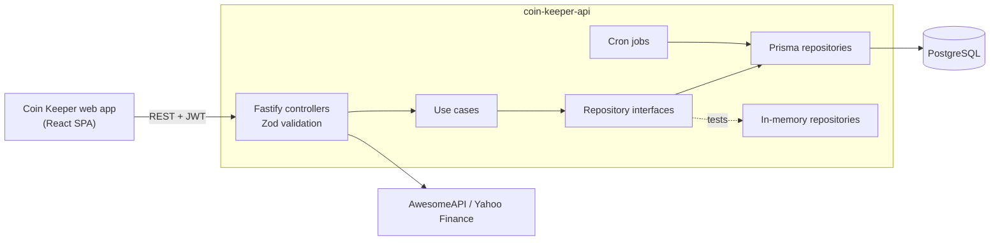

<div align="center">

# Coin Keeper API

**REST API behind [Coin Keeper](https://github.com/RanielliMontagna/coin-keeper), a personal finance tracker for accounts, transactions and credit cards.**


[Features](#features) •
[Architecture](#architecture) •
[Endpoints](#endpoints) •
[Running locally](#running-locally) •
[Tests](#tests) •
[History](#project-history)

</div>

> [!WARNING]
> **Discontinued.** Coin Keeper is no longer maintained. This repository is archived and kept as a portfolio reference. There is no hosted instance, and dependencies have not been updated since mid-2025.

<p align="center">
  
  <br />
  <sub>The web app built on this API. See <a href="https://github.com/RanielliMontagna/coin-keeper">coin-keeper</a> for more screenshots.</sub>
</p>

## About

This is the backend of Coin Keeper, a side project I built in 2023–2024 to track my own money. It handles authentication, bank accounts, categories, income and expenses, recurring transactions and credit card invoices, and it feeds the dashboard with balances, charts and currency quotes.

The code is organised around use cases with repository interfaces, so business rules are tested against in-memory repositories and the HTTP layer is tested end to end against a real PostgreSQL schema.

## Features

- **Authentication**: sign-up and sign-in with bcrypt-hashed passwords, a 10-minute JWT access token and a refresh token in an HTTP-only cookie.
- **Accounts**: bank accounts tied to Brazilian institutions (Nubank, Itaú, Inter, Bradesco, Santander and others) with a running balance.
- **Categories**: user-defined categories with a 20-colour palette.
- **Transactions**: income and expenses with paid/pending status, filters by month and account, latest transactions and a general balance.
- **Charts**: income and expense totals grouped by week, month and year.
- **Recurring transactions**: weekly, monthly or yearly series created in a single request.
- **Credit cards**: limit, brand, closing day and due day, with monthly invoices and card expenses.
- **Settings**: per-user configuration, such as marking transactions as paid on their due date.
- **Scheduled jobs**: daily cron jobs mark due transactions as paid (when enabled) and flag unpaid invoices as overdue.
- **Quotes**: USD, EUR and BTC rates from AwesomeAPI plus the Ibovespa index from Yahoo Finance (RapidAPI), cached in memory.
- **Soft delete**: records keep a `deleted_at` timestamp instead of being removed.

## Architecture



```text
src/
├── http/
│   ├── controllers/     # routes, request validation and e2e specs per resource
│   ├── middlewares/     # JWT verification
│   └── services/        # external quotes
├── use-cases/           # business rules + unit specs, factories wire the repositories
├── repositories/        # interfaces, Prisma and in-memory implementations
├── jobs/                # daily cron jobs
└── lib/                 # Prisma client, axios instances, cron helper
prisma/
├── schema.prisma        # User, Account, Category, Transaction, RecurringTransaction,
│                        # CreditCard, Invoice, InvoiceExpenses, Config
├── migrations/          # 24 migrations, June 2023 to March 2024
└── vitest-environment-prisma/   # isolated schema per e2e test run
```

## Endpoints

Every route except sign-up, sign-in, token refresh and the health check requires a `Bearer` token. Amounts are stored and returned in cents.

| Method | Route | Description |
| --- | --- | --- |
| `GET` | `/` | Health check |
| `POST` | `/users` | Sign up |
| `POST` | `/sessions` | Sign in, returns the access token and sets the refresh cookie |
| `PATCH` | `/token/refresh` | Issue a new access token |
| `GET` | `/me` | Current user profile |
| `GET` `POST` | `/accounts` | List or create accounts |
| `GET` `PUT` `DELETE` | `/accounts/:id` | Read, update or delete an account |
| `GET` | `/accounts/:accountId/transactions` | Transactions of one account |
| `GET` `POST` | `/categories` | List or create categories |
| `GET` `PUT` `DELETE` | `/categories/:id` | Read, update or delete a category |
| `GET` `POST` | `/transactions` | List (filtered by month) or create transactions |
| `DELETE` | `/transactions/:id` | Delete a transaction |
| `PATCH` | `/transactions/:transactionId/paid` | Mark a transaction as paid |
| `GET` | `/transactions/latest` | Latest transactions |
| `GET` | `/transactions/balance` | Balance, income and expenses |
| `GET` | `/transactions/graphics/{week,month,year}` | Chart data |
| `POST` | `/recurring-transactions` | Create a recurring series |
| `GET` `POST` | `/credit-cards` | List or create credit cards |
| `GET` `PUT` `DELETE` | `/credit-cards/:id` | Read, update or delete a credit card |
| `POST` | `/credit-cards/:creditCardId/invoice/expense` | Add an expense to the card's invoice |
| `GET` | `/invoices?month=&year=` | Credit card invoices for a month |
| `GET` `PUT` | `/configs` | Read or update user settings |
| `GET` | `/services/quotes` | Currency and market quotes |

## Tech stack

| Area | Tools |
| --- | --- |
| Runtime | Node.js, TypeScript, tsx (dev), tsup (build) |
| HTTP | Fastify 4, `@fastify/jwt`, `@fastify/cookie`, `@fastify/cors`, Zod |
| Data | Prisma 5, PostgreSQL |
| Jobs | cron |
| External data | axios, AwesomeAPI, Yahoo Finance via RapidAPI, node-cache |
| Tests | Vitest, Supertest, custom Prisma test environment |
| Tooling | ESLint (standard-with-typescript), Prettier, Docker |

## Running locally

Last checked in October 2026 on Node.js 24 with PostgreSQL 16.

```bash
git clone https://github.com/RanielliMontagna/coin-keeper-api.git
cd coin-keeper-api
cp .env.example .env          # set JWT_SECRET; RAPIDAPI_KEY is only needed for quotes

# PostgreSQL (or: docker compose up -d coinkeeper-db)
docker run -d --name coinkeeper-db -p 5432:5432 \
  -e POSTGRES_USER=docker -e POSTGRES_PASSWORD=docker -e POSTGRES_DB=apicoinkeeper \
  postgres:16

npm ci
npx prisma@5.22.0 generate    # the pinned Prisma CLI (5.0) fails to generate on recent Node.js
npx prisma migrate deploy
npm run dev                   # http://localhost:3333
```

Then run the [web app](https://github.com/RanielliMontagna/coin-keeper) with `VITE_API_URL=http://localhost:3333`.

## Tests

```bash
npm test                      # use-case unit tests with in-memory repositories
npm run test:e2e              # HTTP e2e tests, one PostgreSQL schema per run
npm run test:coverage
```

The repository has 75 spec files: unit tests for the use cases and e2e tests for the controllers.

## Project history

- **June 2023**: project setup, Prisma schema, users, accounts, categories and transactions.
- **July 2023**: credit cards, amounts stored in cents, soft delete.
- **February–March 2024**: recurring transactions, paid status, user settings, credit card invoices and the daily jobs.
- **March 2024**: last feature work.
- **2024–2025**: automated dependency upgrades only.
- **October 2026**: archived.

## Related

- [coin-keeper](https://github.com/RanielliMontagna/coin-keeper): the React web app.

## License

[MIT](LICENSE) © Ranielli Montagna
